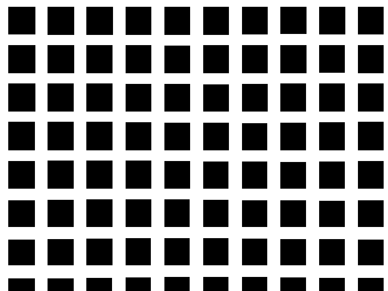

# E1. Illusioni in movimento

Lavoro pubblicato: https://federicabovi.github.io/aa2627-tad-es/es1/

Quando il lavoro è pronto, crea `preview.png` con un fotogramma in cui l’effetto è visibile. L’immagine serve per l’anteprima nella pagina delle revisioni del corso.
